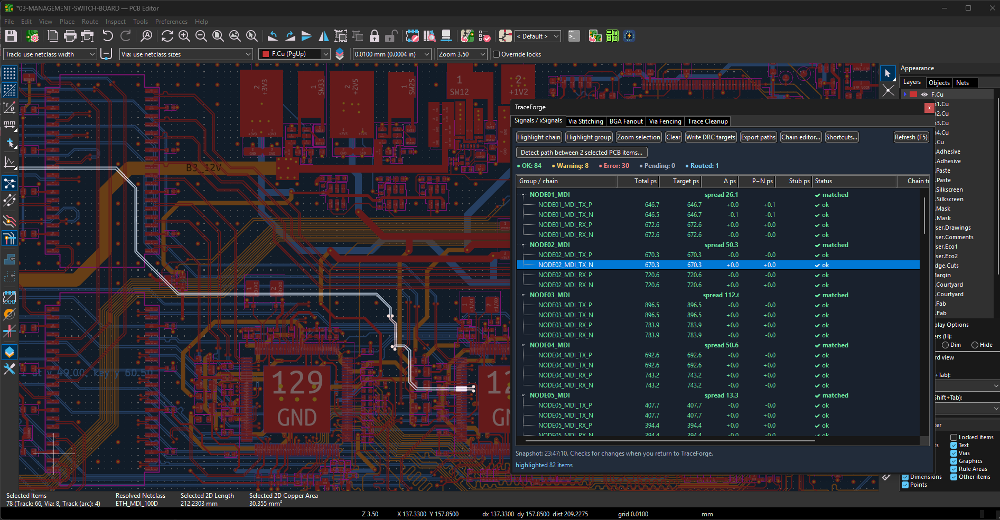
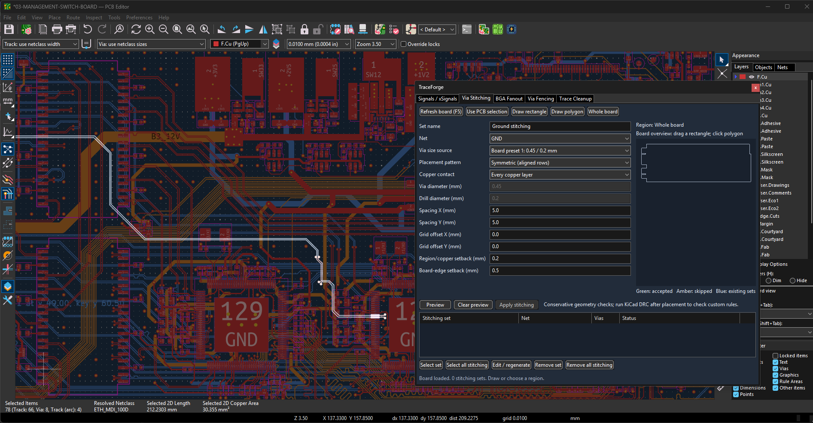
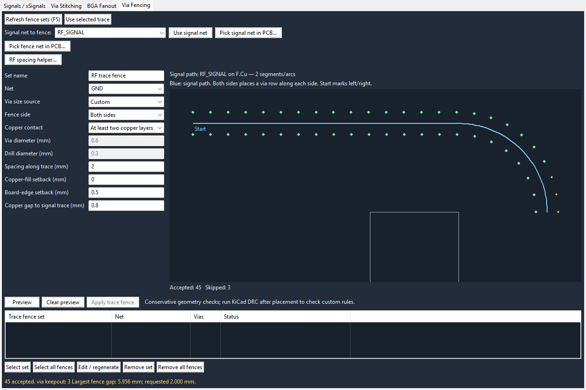
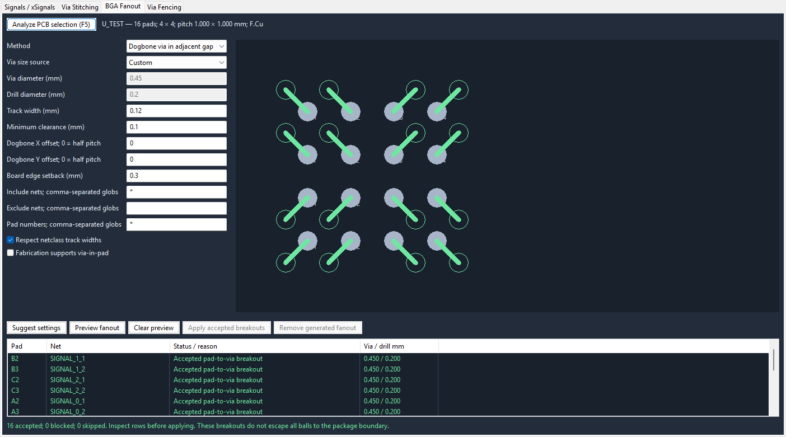
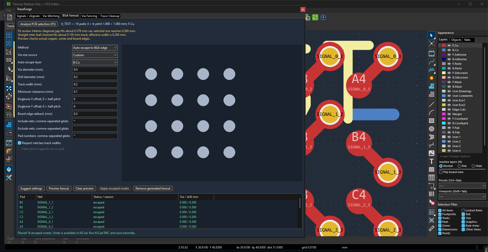
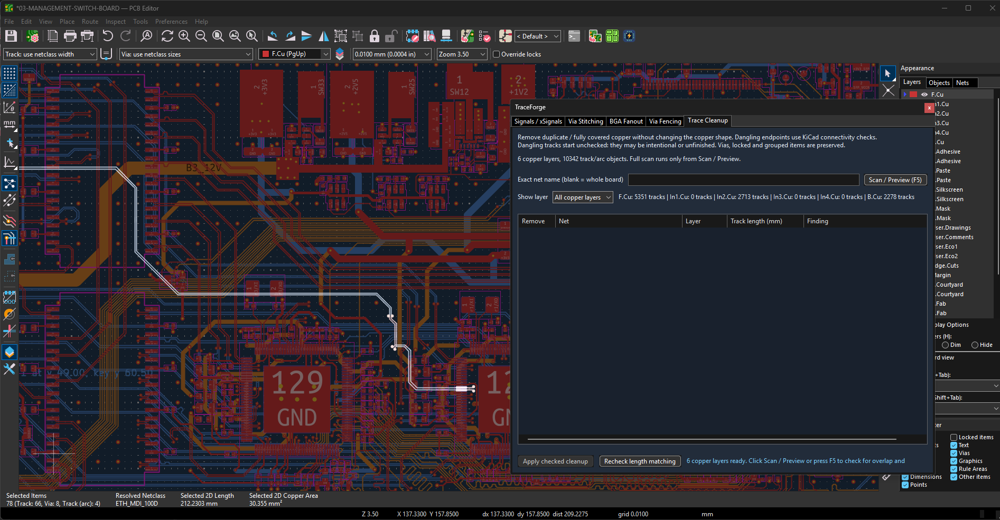

# TraceForge


**Signal paths, trace cleanup, via stitching, RF fencing, BGA fanout and live net colors for KiCad 10 on Windows.**

TraceForge 0.12.0 groups signal analysis, Via Tools, BGA fanout, Trace Tools,
and Visualization in one colored panel. Trace Tools includes cleanup, teardrops,
and rounded corners with persistent restore. It reads the open board through
KiCad's native `pcbnew` bindings, including unsaved routing changes. No official
IPC API setup, API token, or pip runtime dependencies are needed.



*Current TraceForge in PCB Editor on the 03-MANAGEMENT-SWITCH-BOARD project. The
selected signal path is highlighted on the board.*

## Install

**Requirements:** Windows and KiCad 10 with its bundled Python/scripting support.

### KiCad Plugin and Content Manager

Download `TraceForge-<version>-KiCad10-PCM.zip` from a GitHub release. In KiCad
Manager, open **Plugin and Content Manager > Install from file**, select that ZIP,
then close all KiCad windows and reopen PCB Editor. Once KiCad accepts TraceForge into its official catalog,
you can instead install or update it directly from the Manager's Repository tab.

The first launch may assign KiCad's unused **Ctrl+Alt+Shift+F12** shortcut for
native net focus. If TraceForge asks, restart PCB Editor once more. An existing
`user.hotkeys` file is backed up as `user.hotkeys.traceforge.bak`; shortcut
conflicts are reported without changing the existing binding. PCM installation
does not require PowerShell or a manually created plugin junction.

### Standalone Windows ZIP

1. Download the **TraceForge KiCad10 Windows ZIP** from this repository's Releases
   page. Extract it completely into a permanent folder, for example
   `C:\Tools\TraceForge`. Do not run the plugin from inside the ZIP.
2. Save your work and close all KiCad windows, including KiCad Manager.
3. Open the extracted folder, right-click inside it and choose **Open in Terminal**.
   In PowerShell run:

   ```powershell
   powershell.exe -NoProfile -ExecutionPolicy Bypass -File .\tools\install_native_bridge.ps1
   ```

   This applies the script policy to that process only. Administrator access is
   normally unnecessary. The installer creates a junction at
   `%APPDATA%\kicad\10.0\scripting\plugins\traceforge_native_bridge`
   pointing to the extracted `native_bridge` folder. Keep the extracted files there.
4. Start PCB Editor, open and save a board, then click the **TraceForge** toolbar
   icon or **Tools > External Plugins > TraceForge**.
5. Open a feature tab. Use **F5** or **Refresh** to read the open board on demand.

Cloning this repository into a permanent folder and running the same installer
also works. No separate Python installation is needed to use the plugin.

### Update or remove a standalone installation

Close PCB Editor and extract the new version. If its folder differs from the old
installation, run the installer from the new folder with:

```powershell
powershell.exe -NoProfile -ExecutionPolicy Bypass -File .\tools\install_native_bridge.ps1 -ReplaceExisting
```

This switches the plugin junction and preserves the previous installation folder.
The installer refuses to replace an ordinary folder. Restart PCB Editor afterward.
For a Git checkout already linked by the installer, pull updates, rerun the
installer with all KiCad windows closed, and restart PCB Editor.

To uninstall, close PCB Editor and remove **only the junction** at the plugin path
above; keep your board files and TraceForge sidecars. Removing the installation
folder while the junction exists leaves a broken plugin link.

## Choose a tool

| Tab | Workflow |
| --- | --- |
| **Signals / xSignals** | Detect paths through series passives, inspect chain length/timing, highlight differential pairs, export CSV and write reviewed DRC targets. |
| **Via Tools** | Use the selector at the top right to switch between Via Stitching, Via Fencing, and Via Array. Stitching previews symmetric or staggered grids and manages placed sets. Fencing follows an RF trace on either or both sides. Array evens out selected existing vias. |
| **BGA Fanout** | Analyze a selected BGA, check geometric fit, and preview dogbone, via-in-pad, or bounded escape-to-edge routes. |
| **Trace Tools** | Use the selector at the top right for Trace Cleanup, Teardrops, or Round Corners. Cleanup previews redundant copper and dangling ends, supports bulk selection, and removes reviewed tracks with Undo. Teardrops use KiCad's native generator. Round Corners previews a selected radius across all copper layers, rounds eligible existing trace junctions, and restores selected generated corners. |
| **Visualization** | Color net groups and individual nets live, and focus the ratsnest on selected components. |

### Via Array

Select 1–64 vias of the same net, size, drill and layer pair in PCB Editor. Open
**Via Tools**, choose **Via Array** in the selector at the top right, then click
**Read & preview selection**. Auto detect fits the
existing row and column layout by finding the arrangement requiring the least
movement. The two diagrams show current positions and the proposed array.
To override the detected shape, choose **Rows** or **Columns**, enter a fixed
count starting at 1, and click **Preview array**. TraceForge calculates the
other dimension and center-to-center X/Y pitch from the selected via centers'
bounding rectangle. A partial final row or column is centered. It
assigns each via to a target that minimizes total movement; no vias are added.

The preview lists old and new centers. Apply is available only when the array
stays inside the board, passes copper and via spacing checks, and keeps existing
same-net copper contact on connected layers. Apply only moves the vias;
it does not refill zones. Press **B** in PCB Editor whenever you want to
update zone fills. Undo restores the original positions.
This tool rearranges existing vias; **Via Stitching** creates managed new vias.

### Visualization

The Visualization tab assigns a single color to each group of nets. Enter exact net
names, comma-separated glob patterns such as `DDR_DQ*`, or a KiCad net class as
`class:DDR_BYTE0`. Groups must be disjoint. Individual net colors are available for
nets outside groups, such as separate voltage rails. TraceForge rejects conflicting
assignments and stores group definitions in `<board>.traceforge-visual.json`; the
applied colors are saved in KiCad's project file. Applying a color switches KiCad's
net-color display to **All**, which colors pads, traces, vias, and copper zones.
**Reset all net colors to defaults** clears every net color assignment on the open
PCB and removes TraceForge's saved group and individual color definitions.

The separate **Ratsnest visibility** section offers **Show all**, **Hide all**,
and **Add PCB selection**. Select a footprint or one of its pads in PCB Editor,
then click Add PCB selection. The first click isolates that component's nets;
later clicks add nets without hiding previously focused components. The focus list
lets you remove a component while retaining nets shared with others. Show all and
Add PCB selection also turn KiCad's global ratsnest display on if it was set to
None. The first focus action filters the board; later additions update only newly
included nets. A fully routed board has no ratsnest lines to show. These controls affect visibility only;
they do not change connectivity. To edit teardrops, open **Trace Tools**, choose
**Teardrops**, set the options, then click **Apply to PCB**. KiCad generates the
teardrops as an undoable editor operation.

### Signals and path detection

The screenshot above shows the current Signals / xSignals tab on the management
switch board, including chain timing, pair status, and the PCB highlight.

Select two pads, vias, tracks or components, then use **Detect path between 2 selected
PCB items**. Alternatively choose **Pick first, then second** and click each endpoint
in PCB Editor. The Chain Editor supports the same guided workflow.

The detector crosses series resistors and enabled AC-coupling capacitors across
different net names. Review crossed parts, inferred differential partners and any
existing-chain matches before saving. A resistor limit is optional. Component
selections with multiple candidate signals offer a path choice.

Click a chain to highlight and zoom to it. Highlights stay visible during panning
and zooming; changing the native selection or pressing Esc clears them. Green,
amber, red, blue and gray states distinguish matched, warning, error, routed and
pending results. Signals refresh preserves scrolling and expanded groups.

Selecting a path automatically keeps the chain's nets bright while KiCad dims
unrelated copper. This also applies to endpoint detection and both
differential legs. Other branches belonging to those same nets remain bright.
Clear, Esc or a changed native selection releases the effect; panning/zooming keeps it.

For a PCM installation, TraceForge assigns **Ctrl+Alt+Shift+F12** to KiCad's
**Highlight Net (selected nets)** action on first launch if the action is
unassigned and that shortcut is unused. Restart PCB Editor when prompted. For
a standalone installation, rerun the installer with all KiCad windows closed.
Existing custom bindings are preserved; a changed hotkey file is backed up as
`user.hotkeys.traceforge.bak`. A conflict is reported instead of overwritten.
The native **Clear Net Highlighting** action also needs its shortcut enabled.
TraceForge sends these actions directly to KiCad's visible canvas, without global
keyboard input or a polling loop. Net focus is automatic; no checkbox is needed.

See [endpoint detection](docs/SELECTED-ENDPOINTS.md) for details. Saved chain timing
sums whole-net copper, including branches; the endpoint preview follows one routed
path. Neither is an exact reproduction of KiCad's point-to-point tuner. Timing
requires validated project propagation profiles and stackup data. Review driver
orientation and limits before writing DRC targets.

### Via stitching



*This capture precedes Preview; no stitching vias were added to the project.
The 0.11.5 release has a condensed basic form.*

Choose the net, via preset/netclass/custom size, and center-to-center X/Y spacing.
Choose the whole board, a PCB zone/drawing, or draw a rectangle/polygon in the
tab's overview, then **Preview** and **Apply stitching**. Accepted locations are
green; rejected locations are amber. Symmetric is the default placement pattern;
staggered/perimeter patterns, copper-contact rules, grid offsets and setbacks are
under **Advanced options**. Whole-board grids are evaluated without a fixed
5,000-location limit; dense boards can take longer to preview and apply.
The **About** tab and window title show the version currently running; About also
shows the loaded code path and log location when checking an installation.

Select, edit/regenerate or remove tool-created sets from the list. Changes support
KiCad Undo/Redo. Read [stitching usage and checks](docs/VIA-STITCHING-TESTING.md).

### Via fencing



*Current fencing controls over the management board before a signal trace is chosen.
No fence was applied to the project.*

Type the **Signal net to fence** or use **Pick signal net in PCB**. For a specific
section, select connected track segments/arcs and click **Use selected trace**.
Type or pick the separate fence net, normally GND. Choose **Both sides**, **Left**
or **Right**, copper-to-via gap, spacing and via dimensions, then Preview and Apply.

The **RF spacing helper** estimates wavelength/10 or wavelength/20 spacing from
frequency and dielectric data. It does not calculate impedance or choose the
lateral copper gap. Inspect the reported largest gap after skipped locations.
See [RF fencing](docs/VIA-FENCING.md).

### BGA fanout



*Live PCB Editor preview on a disposable 4 by 4 BGA test board: 16 pads escaped
to the field edge. The management board has no BGA footprint.*



*Apply added 16 vias and 32 track segments. KiCad Undo removed them, Redo restored
them, and Remove generated fanout returned the test board to zero tracks and vias.
The removal itself also passed Undo and Redo.*

Select a BGA footprint and open **BGA Fanout**. Review the detected local pitch,
fabrication limits, offsets and filters. Rectangular arrays may have different
spacing in different rows and columns, including an outer ring and inner array.
Zero X/Y offset uses that pad's adjacent gap, with a short-stub cap across
large empty spans.
Fit guidance explains board-rule floors and nominal
inter-ball space; **Suggest settings** evaluates candidates without placing them.
Choose Dogbone, Via-in-pad, or **Auto escape to BGA edge**. The escape preview shows
which selected single-ended pads have a connected route past the pad field and which
are blocked. Apply only reviewed routes. Managed removal preserves edited routing.

Through vias are supported. Via-in-pad requires explicit fabrication confirmation.
Escape endpoints still need onward routing to their destination. Microvias, HDI
layer assignment, differential-pair escape and full-board autorouting are not implemented.
See [BGA fanout](docs/BGA-FANOUT.md).

### Trace Tools



*The real management board reports all six enabled copper layers and track counts
before Scan / Preview. Opening Cleanup does not start the full scan or change copper.*

Scan the whole board or an exact net to find duplicate tracks, overlapping
collinear tracks and native dangling endpoints. Filter findings by copper layer;
partially overlapping same-net segments can be fused into one continuous track.
Every enabled copper layer appears in the summary, including hidden and empty
layers; counts show findings and scanned track objects per layer. Preview rows
highlight in PCB Editor. Redundant copper starts checked; dangling tracks require review and start
unchecked. **Select all** and **Unselect all** affect the shown layer's findings.
Cleanup is undoable. **Recheck length matching** returns to Signals and
refreshes the measurements. Partial overlaps, vias, locked and grouped copper are
preserved. See [trace cleanup](docs/TRACE-CLEANUP.md).

Choose **Teardrops** in the Trace Tools selector. Choose Add or Remove, the whole
board or selected PCB items, and via, PTH, or SMD targets. For Add, set curved
or straight edges, best length and width percentages, and optional maximums.
Illustrations beside each target show where the teardrop appears; `d` is the
pad/via minor size, `L` is the teardrop length, and `W` is its width.
Click **Apply to PCB** to use KiCad's native teardrop generator and Undo. KiCad 10
uses one specified size rule for pad and via targets. Track-to-track teardrops
use Board Setup defaults and must be applied separately. Selected-only scope
does not support track-to-track teardrops. Use **Open advanced KiCad dialog**
for additional KiCad filters. Run KiCad DRC after applying.

Choose **Round Corners** to enter a maximum radius in millimeters. By default,
TraceForge fits a smaller radius where the full value cannot clear adjacent
copper or fit a short segment; uncheck the fit option to require an exact radius.
Use the optional exact-net field to inspect one net. **Preview corners**
checks all copper layers of the open PCB, or only the selected tracks. It counts
eligible corners, fitted smaller bends, and reasons for skipped junctions.
**Round eligible corners**
replaces qualifying straight corners with tangent copper arcs in one undoable
KiCad edit. Branches, pads, vias, existing arcs, locked copper, and corners that
cannot fit the radius are left alone. Select a generated arc or its adjacent
track and click **Restore selected rounded corner(s)** to recover the original
straight corner. **Restore all rounded corners** resets every TraceForge fillet
on the open board, including differential-pair traces. Both work after reopening
the saved board. Keep the fillet
sidecar with the PCB. Recheck length matching and run KiCad DRC after rounding;
the preview is conservative but does not replace the full DRC, including zones
and custom rules. KiCad's shove router cannot drag copper arcs.

## Keep project metadata

Save the PCB normally and keep these sidecars alongside it when copying a project:

| File | Stores |
| --- | --- |
| `<board>.traceforge.json` | Signal-chain definitions and reviewed limits |
| `<board>.traceforge-stitching.json` | Stitching/fencing recipes and owned via UUIDs |
| `<board>.traceforge-fanout.json` | Generated fanout ownership and recipes |
| `<board>.traceforge-fillets.json` | Original corner geometry and generated arc ownership for selective restore |

Removal/regeneration preserves locked or manually altered generated items. Missing
ownership sidecars prevent managed removal. Legacy `xsignals.json` can be imported.

## Refresh, shortcuts and troubleshooting

Opening a tab or returning from PCB Editor checks for changes once and refreshes
stale data. There is no continuous board/selection polling or automatic retry loop.
F5 forces a refresh. All board operations share one worker; large previews and zone
refills can briefly occupy KiCad's GUI thread.

Default shortcuts: **Ctrl+Alt+H** highlight chain, **Ctrl+Alt+G** highlight group,
**Ctrl+Alt+C** clear, **Ctrl+Alt+W** write DRC targets, **Ctrl+Alt+E** export CSV,
**Ctrl+Alt+T** show/hide. Configure them through **Shortcuts**.

- **Plugin missing:** confirm the installer succeeded and restart PCB Editor.
- **Old panel after updating:** close TraceForge and restart PCB Editor.
- **Pick waiting:** click one item in PCB Editor; Esc cancels. Picks expire after 90 seconds.
- **No path:** check that routing is continuous and passive traversal is enabled.
- **No via candidates:** refill zones, check fence/stitch net copper on two layers,
  and review the preview's clearance/keepout rejection reasons.
- **Multiple boards open:** launch TraceForge from the intended editor's toolbar.
- **Logs:** `%APPDATA%\TraceForge\traceforge.log`.

## Scope and development

Run KiCad DRC after generated placement; custom-rule and RF validation are incomplete.
Live parallel multirouting is planned, not implemented. This release targets KiCad
10 on Windows and uses its legacy pcbnew bindings; KiCad 11 is not supported.
See [feature scope](docs/FEATURE-SCOPE.md) and [native access](docs/NATIVE-BOARD-ACCESS.md).

Development checks:

```powershell
python -m pip install -e ".[dev]"
python -m ruff check .
python -m compileall -q signal_path_analyzer native_bridge tools
python tools/build_release.py
```

The build writes a standalone ZIP and `SHA256SUMS.txt` under `dist/`, using an
explicit public-file allowlist. Tests, fixtures, logs, caches, credentials and user
boards are ignored. `tools/build_chains.py` is an optional offline chain builder;
`tools/make_icons.py` regenerates icons with Pillow installed.

See [PCM publishing steps](docs/PCM-PUBLISHING.md),
[release notes](docs/RELEASE-NOTES.md), [changelog](CHANGELOG.md) and
[MIT license](LICENSE).
