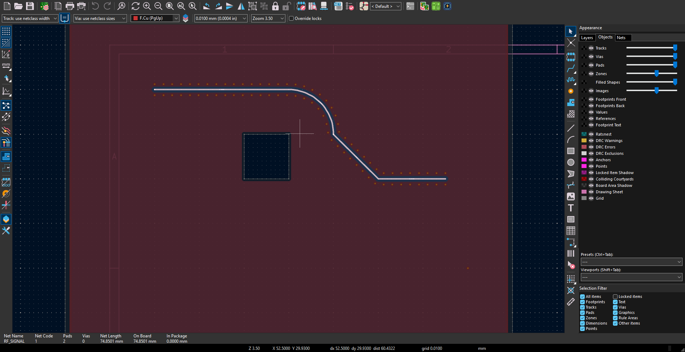

# TraceForge

**Signal paths, via stitching, RF fencing and BGA fanout for KiCad 10 on Windows.**

TraceForge puts four PCB tools in one colored panel. It reads the open board through
KiCad's native `pcbnew` bindings, including unsaved routing changes. No official
IPC API setup, API token, or pip runtime dependencies are needed.


*Actual TraceForge interface using a synthetic demonstration board. Green points
are accepted preview locations; placement requires Apply.*

## Install

**Requirements:** Windows and KiCad 10 with its bundled Python/scripting support.

1. Download the **TraceForge KiCad10 Windows ZIP** from this repository's Releases
   page. Extract it completely into a permanent folder, for example
   `C:\Tools\TraceForge`. Do not run the plugin from inside the ZIP.
2. Save your work and close every PCB Editor window.
3. Open the extracted folder, right-click inside it and choose **Open in Terminal**.
   In PowerShell run:

   ```powershell
   powershell.exe -NoProfile -ExecutionPolicy Bypass -File .\tools\install_native_bridge.ps1
   ```

   This applies the script policy to that process only. Administrator access is
   normally unnecessary. The installer creates a junction at
   `%APPDATA%\kicad\10.0\scripting\plugins\traceforge_native_bridge`
   pointing to the extracted `native_bridge` folder. Keep the extracted files there.
4. Start PCB Editor, open and save a board, then click the **TraceForge** toolbar
   icon or **Tools > External Plugins > TraceForge**.
5. Open a feature tab. It loads automatically. **F5** or **Refresh** forces a refresh.

Cloning this repository into a permanent folder and running the same installer
also works. No separate Python installation is needed to use the plugin.

### Update or remove

Close PCB Editor and extract the new version. If its folder differs from the old
installation, run the installer from the new folder with:

```powershell
powershell.exe -NoProfile -ExecutionPolicy Bypass -File .\tools\install_native_bridge.ps1 -ReplaceExisting
```

This switches the plugin junction and preserves the previous installation folder.
The installer refuses to replace an ordinary folder. Restart PCB Editor afterward.
For a Git checkout already linked by the installer, pull updates and restart it.

To uninstall, close PCB Editor and remove **only the junction** at the plugin path
above; keep your board files and TraceForge sidecars. Removing the installation
folder while the junction exists leaves a broken plugin link.

## Choose a tool

| Tab | Workflow |
| --- | --- |
| **Signals / xSignals** | Detect paths through series passives, inspect chain length/timing, highlight differential pairs, export CSV and write reviewed DRC targets. |
| **Via Stitching** | Preview symmetric or staggered via grids in a whole board, selected zone, rectangle or polygon; select, regenerate or remove managed sets. |
| **BGA Fanout** | Analyze a selected BGA, suggest geometry-checked settings and preview dogbone or explicitly confirmed via-in-pad breakouts. |
| **Via Fencing** | Place managed ground-via rows on either or both sides of a routed RF trace; control copper gap, spacing and via size. |

### Signals and path detection


*Synthetic example chains evaluated by TraceForge's timing engine. The sample
6 ps/mm propagation profile illustrates the interface, not manufacturing guidance.*

Select two pads, vias, tracks or components, then use **Detect path between 2 selected
PCB items**. Alternatively choose **Pick first, then second** and click each endpoint
in PCB Editor. The Chain Editor supports the same guided workflow.

The detector crosses series resistors and enabled AC-coupling capacitors across
different net names. Review crossed parts, inferred differential partners and any
existing-chain matches before saving. A resistor limit is optional. Component
selections with multiple candidate signals offer a path choice.

Click a chain to highlight and zoom to it. Highlights stay visible during panning
and zooming; changing the native selection or pressing Esc clears them. Green,
amber, red, blue and gray states distinguish matched, warning, error, routed and
pending results. Signals refresh preserves scrolling and expanded groups.

Enable **Dim unrelated nets** in Signals to keep the chain's nets bright while
KiCad dims unrelated copper. This also applies to endpoint detection and both
differential legs. Other branches belonging to those same nets remain bright.
Clear, Esc or a changed native selection releases the effect; panning/zooming keeps it.



*Actual PCB Editor result on a synthetic board with native net focus enabled.*

For this option, rerun the installer with PCB Editor closed, then restart it.
The installer assigns **Ctrl+Alt+Shift+F12** to KiCad's **Highlight Net (selected
nets)** action only if it is unassigned and that shortcut is unused. Existing
custom bindings are preserved; a changed hotkey file is backed up as
`user.hotkeys.traceforge.bak`. A conflict is reported instead of overwritten.
The native **Clear Net Highlighting** action also needs its shortcut enabled.
TraceForge sends these actions directly to KiCad's visible canvas, without global
keyboard input or a polling loop. The checkbox is optional and off initially.

See [endpoint detection](docs/SELECTED-ENDPOINTS.md) for details. Saved chain timing
sums whole-net copper, including branches; the endpoint preview follows one routed
path. Neither is an exact reproduction of KiCad's point-to-point tuner. Timing
requires validated project propagation profiles and stackup data. Review driver
orientation and limits before writing DRC targets.

### Via stitching


Choose the net, via preset/netclass/custom size, spacing and setbacks. Choose the
whole board, a PCB zone/drawing, or draw a rectangle/polygon in the tab's overview.
Select **Symmetric**, **Staggered**, or a perimeter pattern, then **Preview** and
**Apply stitching**. Accepted locations are green; rejected locations are amber.

Select, edit/regenerate or remove tool-created sets from the list. Changes support
KiCad Undo/Redo. Read [stitching usage and checks](docs/VIA-STITCHING-TESTING.md).

### Via fencing

Type the **Signal net to fence** or use **Pick signal net in PCB**. For a specific
section, select connected track segments/arcs and click **Use selected trace**.
Type or pick the separate fence net, normally GND. Choose **Both sides**, **Left**
or **Right**, copper-to-via gap, spacing and via dimensions, then Preview and Apply.

The **RF spacing helper** estimates wavelength/10 or wavelength/20 spacing from
frequency and dielectric data. It does not calculate impedance or choose the
lateral copper gap. Inspect the reported largest gap after skipped locations.
See [RF fencing](docs/VIA-FENCING.md).

### BGA fanout


*Native geometry-checked preview on a synthetic 4 by 4, 1 mm-pitch BGA: 16 accepted
pad-to-via breakouts. This preview has not been applied to a user board.*

Select a BGA footprint and open **BGA Fanout**. Review detected pitch, fabrication
limits, offsets and filters. **Suggest settings** evaluates candidates without
placing them. Preview accepted pad-to-via breakouts, then Apply. Managed generated
fanout can be removed while preserving manually edited routing.

Through vias are supported. Via-in-pad requires explicit fabrication confirmation.
Microvias, HDI layer assignment and full escape routing are not implemented.
See [BGA fanout](docs/BGA-FANOUT.md).

## Keep project metadata

Save the PCB normally and keep these sidecars alongside it when copying a project:

| File | Stores |
| --- | --- |
| `<board>.traceforge.json` | Signal-chain definitions and reviewed limits |
| `<board>.traceforge-stitching.json` | Stitching/fencing recipes and owned via UUIDs |
| `<board>.traceforge-fanout.json` | Generated fanout ownership and recipes |

Removal/regeneration preserves locked or manually altered generated items. Missing
ownership sidecars prevent managed removal. Legacy `xsignals.json` can be imported.

## Refresh, shortcuts and troubleshooting

Opening a tab or returning from PCB Editor checks for changes once and refreshes
stale data. There is no continuous board/selection polling or automatic retry loop.
F5 forces a refresh. All board operations share one worker; large previews and zone
refills can briefly occupy KiCad's GUI thread.

Default shortcuts: **Ctrl+Alt+H** highlight chain, **Ctrl+Alt+G** highlight group,
**Ctrl+Alt+C** clear, **Ctrl+Alt+W** write DRC targets, **Ctrl+Alt+E** export CSV,
**Ctrl+Alt+T** show/hide. Configure them through **Shortcuts**.

- **Plugin missing:** confirm the installer succeeded and restart PCB Editor.
- **Old panel after updating:** close TraceForge and restart PCB Editor.
- **Pick waiting:** click one item in PCB Editor; Esc cancels. Picks expire after 90 seconds.
- **No path:** check that routing is continuous and passive traversal is enabled.
- **No via candidates:** refill zones, check fence/stitch net copper on two layers,
  and review the preview's clearance/keepout rejection reasons.
- **Multiple boards open:** launch TraceForge from the intended editor's toolbar.
- **Logs:** `%APPDATA%\TraceForge\traceforge.log`.

## Scope and development

Run KiCad DRC after generated placement; custom-rule and RF validation are incomplete.
Live parallel multirouting is planned, not implemented. This release targets KiCad
10 on Windows and uses its legacy pcbnew bindings; KiCad 11 is not supported.
See [feature scope](docs/FEATURE-SCOPE.md) and [native access](docs/NATIVE-BOARD-ACCESS.md).

Development checks:

```powershell
python -m pip install -e ".[dev]"
python -m ruff check .
python -m compileall -q signal_path_analyzer native_bridge tools
python tools/build_release.py
```

The build writes a standalone ZIP and `SHA256SUMS.txt` under `dist/`, using an
explicit public-file allowlist. Tests, fixtures, logs, caches, credentials and user
boards are ignored. `tools/build_chains.py` is an optional offline chain builder;
`tools/make_icons.py` regenerates icons with Pillow installed.

See [release notes](docs/RELEASE-NOTES.md), [changelog](CHANGELOG.md) and [MIT license](LICENSE).
