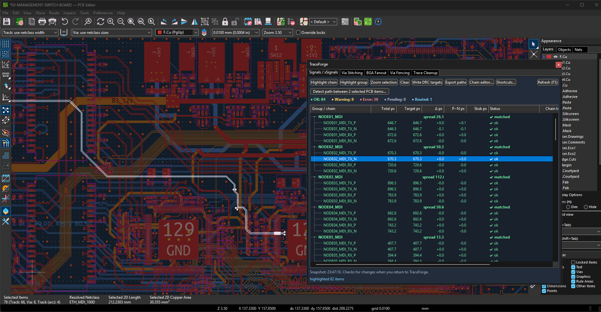
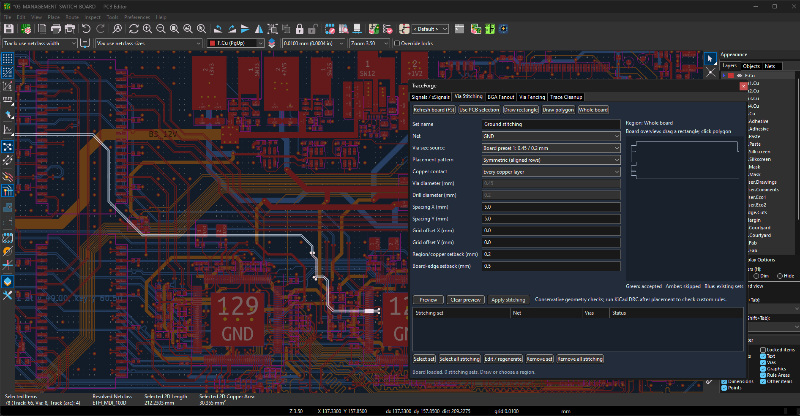
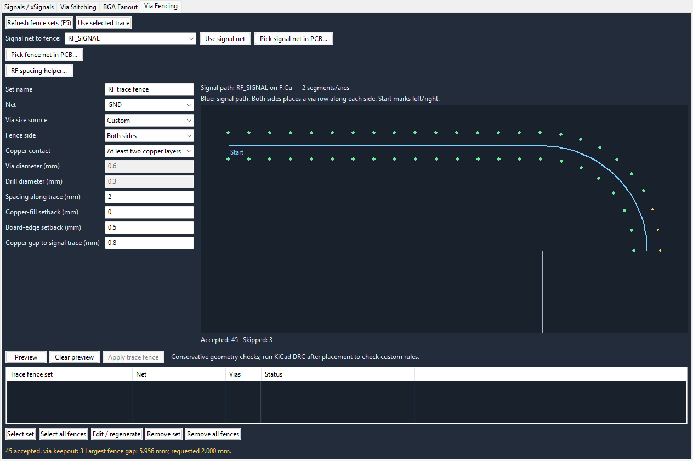
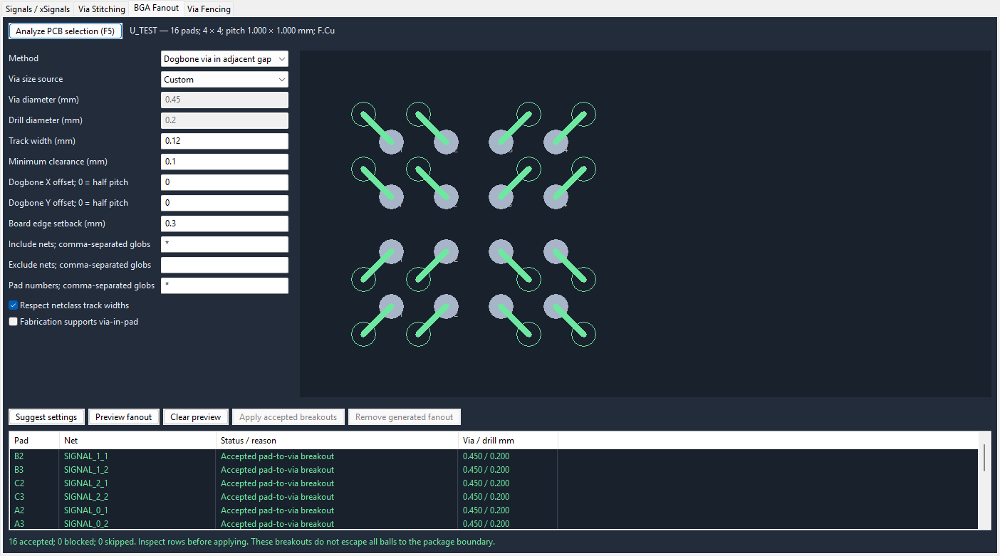
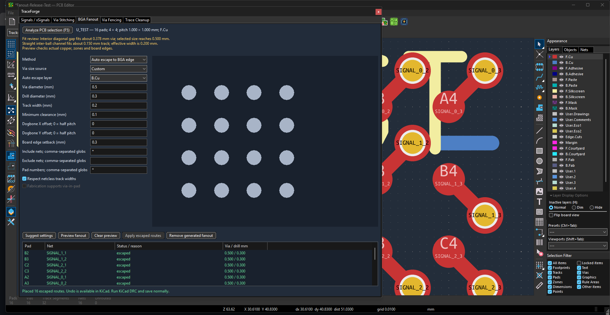
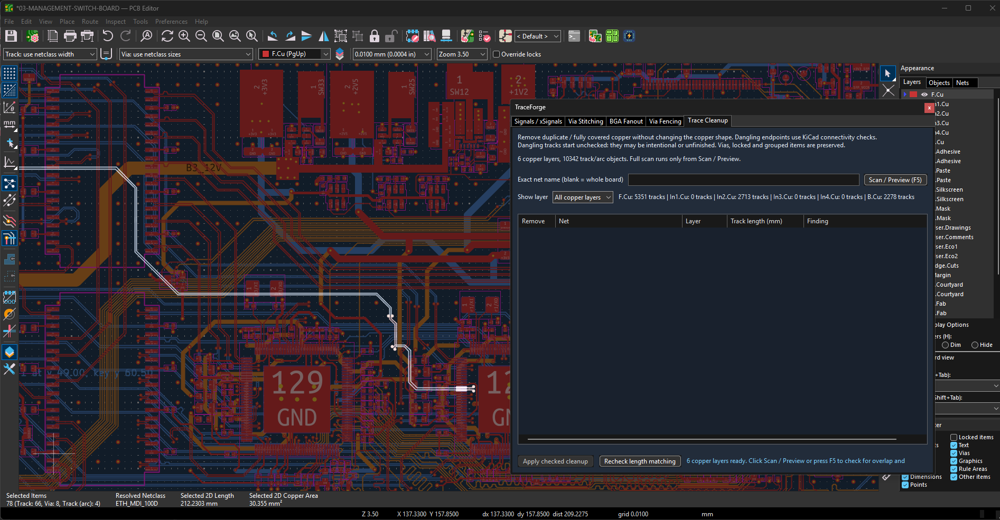

# TraceForge


**PCB analysis and editing tools for KiCad 10. Version 0.13.3 is released for Windows; the older macOS 0.13.1 build remains a testing preview.**

TraceForge 0.13.3 groups signal analysis, five Via Tools, BGA fanout, three Trace Tools,
PCB Rotation, Visualization, and Manufacturing in one panel. It reads the open board through
KiCad's native `pcbnew` bindings, including unsaved routing changes. The PCB
tools need no IPC API setup or token. Manufacturing exports read saved files and
need a separate Python with `openpyxl`.



*Current TraceForge in PCB Editor on the 03-MANAGEMENT-SWITCH-BOARD project. The
selected signal path is highlighted on the board.*

## Features

Open TraceForge from KiCad PCB Editor. Each main tab is listed below; **Via Tools**
and **Trace Tools** have a selector at the top right for their individual tools.

| Tool | What it does | Detailed use |
| --- | --- | --- |
| Signals / xSignals | Finds routed paths across selected series resistors and capacitors; measures copper length and, with a valid project timing profile, delay and group skew; highlights paths and differential partners; saves reviewed chains, exports CSV, and writes reviewed DRC targets. | [Signals and path detection](#signals-and-path-detection) |
| Via Stitching | Previews and adds same-net via grids in a chosen region, with copper, clearance, keepout and assembly checks; manages generated via sets. Its cleanup view finds standalone through vias for selection and manual deletion. | [Via stitching](#via-stitching) |
| Via Fencing | Places a row of vias beside a selected signal trace, using a separate fence net; includes an RF spacing estimate. | [Via fencing](#via-fencing) |
| Via Array | Rearranges an existing selection of matching vias into aligned rows and columns without adding vias. | [Via Array](#via-array) |
| Via Size Manager | Inventories presets and placed via sizes; filters, selects, deletes, or checks and enlarges eligible through vias. | [Via Size Manager](#via-size-manager) |
| Via-in-Pad Inspector | Finds full, partial-hole and annulus-only pad overlap on any net; groups findings by component and focuses each result in PCB Editor. It reports geometry; it does not change vias. | [Via-in-Pad Inspector](#via-in-pad-inspector) |
| BGA Fanout | Checks a selected BGA's pitch and rules, previews dogbone, via-in-pad or bounded escape routes, and applies reviewed breakouts. | [BGA fanout](#bga-fanout) |
| Trace Cleanup | Finds duplicate, fully covered and eligible overlapping same-net tracks plus dangling ends; previews and removes reviewed findings. | [Trace Cleanup](#trace-cleanup) |
| Teardrops | Adds or removes native KiCad teardrops at selected via, pad and track targets. | [Teardrops](#teardrops) |
| Round Corners | Previews and rounds eligible track bends with copper arcs; restores selected or all generated bends. | [Round Corners](#round-corners) |
| PCB Rotation | Rotates selected footprints by an exact angle in one undoable operation. | [PCB Rotation](#pcb-rotation) |
| Visualization | Applies live net and net-group colors and controls component-focused ratsnest visibility. | [Visualization](#visualization) |
| Manufacturing | Sets manufacturer choices, runs saved-project checks, creates PCBWay or PCBPower packages, reviews/rebuilds output, and cleans unused local library entries. | [Manufacturing](#manufacturing) |

Read [installation](#install) before first use and [troubleshooting](#if-a-result-looks-wrong)
when a scan or timing value looks unexpected. Features that edit the PCB use KiCad Undo;
save the board after reviewing changes and run KiCad DRC before manufacture.

## Install

**Requirements for 0.13.3:** KiCad 10 with Python scripting support on Windows.
This release has one Windows PCM asset. The older macOS 0.13.1 preview is a
separate release and is not updated by 0.13.3.

### Install the Windows PCM package

Download `TraceForge-0.13.3-KiCad10-PCM.zip` from the
[0.13.3 GitHub release](https://github.com/SamuelCicuitStudio/traceforge-kicad/releases/tag/v0.13.3).
In KiCad Manager, open **Plugin and Content Manager > Install from file** and
select the ZIP. Close all KiCad windows and reopen PCB Editor. If an older
TraceForge remains installed, remove it in PCM first. The **About** tab and
window title must show **0.13.3**; if not, KiCad is still loading old files.
The GitHub ZIP is available independently of KiCad's official PCM catalog.

The first launch may assign KiCad's unused **Ctrl+Alt+Shift+F12** shortcut for
native net focus. If TraceForge asks, restart PCB Editor once more. An existing
`user.hotkeys` file is backed up as `user.hotkeys.traceforge.bak`; shortcut
conflicts are reported without changing the existing binding. PCM installation
does not require PowerShell or a manually created plugin junction.

### Older manual installers

The separate Windows and macOS standalone installers belong to the archived
[0.13.1 releases](https://github.com/SamuelCicuitStudio/traceforge-kicad/releases).
They are not 0.13.3 assets. For this release, install the Windows PCM ZIP above.

## How to use the panel

Start each tool from an open PCB in **PCB Editor**. Use its **Refresh**, **Scan**,
or **Analyze** button after changing the board; TraceForge does not continuously
poll or silently apply stale previews. Actions that change copper are previewed
first and use KiCad Undo. Save the PCB yourself after reviewing the result.

### If a result looks wrong

| What you see | What it means and what to do |
| --- | --- |
| A routed signal says **timing profile missing**, with blank ps cells | At least one net has no project tuning profile or a routed layer has no delay entry. In **Board Setup > Net Classes**, assign the net to a timed class and check its profile for every used copper layer. Save the project, restart/reopen PCB Editor if needed, then refresh TraceForge. A routed length in mm alone is not enough to calculate ps. TraceForge does not write a timing DRC target for this chain. |
| A chain shows **Source PCB ps/mm** | This is the sum of all copper on the first net before series parts, including branches. It is shown for inspection; it is **not** a pin-to-resistor path length. TraceForge 0.13.3 does not create an automatic 15 ps source-net limit. Only a value you enter in **Signal Chain Editor > Source net max ps** makes it a checked rule. |
| Clicking **Pick** or selecting a PCB item yields nothing | In KiCad's **Selection Filter**, enable the item type you need: Tracks, Pads, Vias or Footprints (or choose All Items). An empty filter prevents KiCad's canvas from selecting. Board-wide scans do not depend on that filter; selecting or focusing results in KiCad does. |
| Via-in-Pad Inspector shows **full**, **hole**, or **annulus only** | These describe copper geometry, not whether fabrication has filled or capped the via. Red hole contact can be on a different net; inspect both net names before editing. The colored results are in TraceForge's list; clicking a row focuses the via in KiCad. |
| **Find standalone vias** lists a zone-only via | A via connected only by filled zones can be intentional stitching. Inspect connected layers and choose individual rows or **Select all listed in PCB** only after reviewing. Delete in KiCad, then press **B** to refill zones when ready. The scan never deletes vias. |
| Trace Cleanup reports a track inside another | Fully covered, same-net copper can be removed without changing the wider track. Equal-width partial collinear overlaps can be fused after preview. Different-width partial overlaps that add copper outside the wider track are preserved. Review checked findings before applying. |
| Copper looks stale after a deletion | Delete actions deliberately avoid automatic zone refill. Press **B** in PCB Editor before DRC or manufacturing export. |

### Cancel long scans and previews

The **Cancel operation** button stays above all tabs. It is enabled for Via Size
Manager analysis, stitching/RF-fencing previews, BGA fanout previews and trace
cleanup scans. Cancel requests a cooperative stop in the KiCad helper and stops
an active temporary-board DRC subprocess. Unfinished results are discarded and
cannot be applied. Native C++ calls already in progress finish at a safe boundary
before the cancellation is acknowledged.

Apply, Delete, Replace and Remove are atomic undoable edits: cancellation stays
disabled during these operations. Close the panel to request cancellation of an
active read-only scan; do not terminate PCB Editor to stop a scan.

### Stitching assembly protection (0.12.9)

Stitching and RF fencing now protect fiducial optical openings and component
courtyards on both sides, in addition to copper clearance and explicit via keepouts.
Fiducials are detected by reference/value/library name. The default optical margin
is **1.0 mm from pad copper**, increased when necessary to clear the solder-mask
opening plus the component margin. General courtyard margin is **0.25 mm**;
missing courtyards use physical footprint bounds without reference/value text.
Critical references default to **X*, Y*, J*** with **0.50 mm** extra clearance.
All margins are measured from the via's copper edge, not its center.

Use **Advanced options** to change margins or add critical reference patterns
such as `U7,RF*,ANT*`. The **Protect component courtyards** checkbox controls
ordinary components; fiducials and explicitly critical references remain protected.
The preview shows dotted protection bounds, skipped-site counts and reasons.
These assembly margins are configurable project policy, not PCBWay sign-off.
Sensitive regions without recognizable footprints still need explicit KiCad
via keepout areas. Existing misplaced vias are not silently deleted: select a
managed stitching set, **Edit / regenerate**, preview and replace it to apply
these protections to the old placement.

### Via Size Manager

Via filter selection now **replaces KiCad's actual selection** and verifies exact
via UUIDs after synchronization. It does not select other vias, pads or tracks
merely because they share GND. Right-click editing uses that native selection.
Neutral renderer dimming avoids highlighting the entire filtered net; unconnected
net-0 copper can remain undimmed. When neutral dimming is unavailable, the tool
reports that explicitly instead of expanding the selection to a whole net.


In **Via Tools**, choose **Via Size Manager**, then **Refresh sizes (F5)**.
The list merges live project presets, netclass defaults and sizes actually placed.
Unused presets remain visible with **0 used**, and project sizes are also available
as enlargement targets. Click **Refresh sizes (F5)** after editing Board Setup.
Filter by a diameter/drill combination, net, or current PCB selection.
**Select matching in PCB** highlights the matching vias; **Delete matching...**
confirms the count, protects locked vias, and creates one undoable board edit.
Deletion can remove connectivity and must be followed by project DRC review.

When only the drill changes and the copper diameter stays the same, the tool uses
**local hole checks** instead of full-board routing DRC: annular-ring and hole-size
limits, nearby hole/copper clearance, and board-edge/cutout clearance. Existing
copper clearance is unchanged. Custom bounds are applied conservatively; complex
or geometry-dependent custom rules, backdrilling or stale zone fills fall back to
full DRC. This is not a blanket approval for every via with the same diameter.
The preview states which check path ran. Drill-only apply avoids zone refill when
copper envelopes are unchanged. Changes to the live drill constraints invalidate
that preview as well.

For larger stitching vias, choose a target such as **0.60 / 0.30 mm** and click
**Analyze enlargement**. Save project settings before scanning. The scan snapshots
the live PCB, copies its saved project and custom rules, refills zones on temporary
copies, and runs KiCad 10 DRC. It rejects vias associated with new or changed
findings, then tests the remaining candidates together. It does not waive existing
errors or prove a board ready for production. Conservative rejection can miss
other feasible combinations; this is not a global maximum-size solver.

The preview shows green eligible vias, red blocked vias, reasons, and both the
filtered and whole-board counts still below the target drill. Click a result row
to focus that via in PCB Editor. **Apply verified vias** resizes only the tested
batch in one undoable transaction and refills zones. Board/project/rule changes
invalidate the preview. No PCB source is saved automatically.

Automatic enlargement supports unlocked, uniform ordinary through vias. Custom
padstacks, microvias, blind/buried vias and shrinking targets are skipped. Physical
design rules are checked; thermal performance, signal integrity, supplier pricing
and final manufacturing approval still need engineering review. Larger stitching
vias alone do not remove small drilling elsewhere on the PCB.

### Via Array

Select 1–64 vias of the same net, size, drill and layer pair in PCB Editor. Open
**Via Tools**, choose **Via Array** in the selector at the top right, then click
**Read & preview selection**. Auto detect fits the
existing row and column layout by finding the arrangement requiring the least
movement. The two diagrams show current positions and the proposed array.
To override the detected shape, choose **Rows** or **Columns**, enter a fixed
count starting at 1, and click **Preview array**. TraceForge calculates the
other dimension and center-to-center X/Y pitch from the selected via centers'
bounding rectangle. A partial final row or column is centered. It
assigns each via to a target that minimizes total movement; no vias are added.

The preview lists old and new centers. Apply is available only when the array
stays inside the board, passes copper and via spacing checks, and keeps existing
same-net copper contact on connected layers. Apply only moves the vias;
it does not refill zones. Press **B** in PCB Editor whenever you want to
update zone fills. Undo restores the original positions.
This tool rearranges existing vias; **Via Stitching** creates managed new vias.

### Visualization

The Visualization tab assigns a single color to each group of nets. Enter exact net
names, comma-separated glob patterns such as `DDR_DQ*`, or a KiCad net class as
`class:DDR_BYTE0`. Groups must be disjoint. Individual net colors are available for
nets outside groups, such as separate voltage rails. TraceForge rejects conflicting
assignments and stores group definitions in `<board>.traceforge-visual.json`; the
applied colors are saved in KiCad's project file. Applying a color switches KiCad's
net-color display to **All**, which colors pads, traces, vias, and copper zones.
**Reset all net colors to defaults** clears every net color assignment on the open
PCB and removes TraceForge's saved group and individual color definitions.

The separate **Ratsnest visibility** section offers **Show all**, **Hide all**,
and **Add PCB selection**. Select a footprint or one of its pads in PCB Editor,
then click Add PCB selection. The first click isolates that component's nets;
later clicks add nets without hiding previously focused components. The focus list
lets you remove a component while retaining nets shared with others. Show all and
Add PCB selection also turn KiCad's global ratsnest display on if it was set to
None. The first focus action filters the board; later additions update only newly
included nets. A fully routed board has no ratsnest lines to show. These controls affect visibility only;
they do not change connectivity. To edit teardrops, open **Trace Tools**, choose
**Teardrops**, set the options, then click **Apply to PCB**. KiCad generates the
teardrops as an undoable editor operation.

### Signals and path detection

The screenshot above shows the current Signals / xSignals tab on the management
switch board, including chain timing, pair status, and the PCB highlight.

Select two pads, vias, tracks or components, then use **Detect path between 2 selected
PCB items**. Alternatively choose **Pick first, then second** and click each endpoint
in PCB Editor. The Chain Editor supports the same guided workflow.

The detector crosses series resistors and enabled AC-coupling capacitors across
different net names. Review crossed parts, inferred differential partners and any
existing-chain matches before saving. A resistor limit is optional. Component
selections with multiple candidate signals offer a path choice.

Click a chain to highlight and zoom to it. Highlights stay visible during panning
and zooming; changing the native selection or pressing Esc clears them. Green,
amber, red, blue and gray states distinguish matched, warning, error, routed and
pending results. Signals refresh preserves scrolling and expanded groups.

Selecting a path automatically keeps the chain's nets bright while KiCad dims
unrelated copper. This also applies to endpoint detection and both
differential legs. Other branches belonging to those same nets remain bright.
Clear, Esc or a changed native selection releases the effect; panning/zooming keeps it.

For a PCM installation, TraceForge assigns **Ctrl+Alt+Shift+F12** to KiCad's
**Highlight Net (selected nets)** action on first launch if the action is
unassigned and that shortcut is unused. Restart PCB Editor when prompted. For
a standalone installation, rerun the installer with all KiCad windows closed.
Existing custom bindings are preserved; a changed hotkey file is backed up as
`user.hotkeys.traceforge.bak`. A conflict is reported instead of overwritten.
The native **Clear Net Highlighting** action also needs its shortcut enabled.
TraceForge sends these actions directly to KiCad's visible canvas, without global
keyboard input or a polling loop. Net focus is automatic; no checkbox is needed.

See [endpoint detection](docs/SELECTED-ENDPOINTS.md) for details. Saved chain timing
sums whole-net copper, including branches; the endpoint preview follows one routed
path. Neither is an exact reproduction of KiCad's point-to-point tuner. Timing
requires validated project propagation profiles and stackup data. Review driver
orientation and limits before writing DRC targets.

If you set an explicit **Source net max ps** value, TraceForge compares it to
track plus via delay on the entire first net before series parts, including
branches. It is not a point-to-point source-to-resistor measurement. Package
pad-to-die delay remains in whole-chain timing and matching targets. Endpoint
path previews report additional contacts separately; that notice does not
mean the source-net limit was exceeded.

### Via stitching



*This capture precedes Preview; no stitching vias were added to the project.
The 0.11.5 release has a condensed basic form.*

Choose the net, via preset/netclass/custom size, and center-to-center X/Y spacing.
Choose the whole board, a PCB zone/drawing, or draw a rectangle/polygon in the
tab's overview, then **Preview** and **Apply stitching**. Accepted locations are
green; rejected locations are amber. Symmetric is the default placement pattern;
staggered/perimeter patterns, copper-contact rules, grid offsets and setbacks are
under **Advanced options**. Whole-board grids are evaluated without a fixed
5,000-location limit; dense boards can take longer to preview and apply.
The **About** tab and window title show the version currently running; About also
shows the loaded code path and log location when checking an installation.

Select, edit/regenerate or remove tool-created sets from the list. Changes support
KiCad Undo/Redo. Read [stitching usage and checks](docs/VIA-STITCHING-TESTING.md).

The **Avoid vias touching SMT pads** option is on by default; turn it off only
when same-net pad contact is intentional and your fabrication process supports it.
Click **Standalone via cleanup** at the top of this tab to replace the placement
form with a full-height list; **Placement setup** returns to the form. The scan
finds through vias with no direct track, pad, other-via or copper-drawing contact,
including vias placed outside managed stitching sets. Results show net, position,
drill, lock state and connected copper-layer count. Click one to focus it, or
select all listed unlocked vias in PCB Editor for manual deletion. Zone-only
vias can be valid stitching; the optional **fewer than two connected copper
layers** filter narrows the list. Scanning and selecting do not delete vias or
refill zones. After deleting in KiCad, press **B** when ready to refill.

### Via fencing



*Current fencing controls over the management board before a signal trace is chosen.
No fence was applied to the project.*

Type the **Signal net to fence** or use **Pick signal net in PCB**. For a specific
section, select connected track segments/arcs and click **Use selected trace**.
Type or pick the separate fence net, normally GND. Choose **Both sides**, **Left**
or **Right**, copper-to-via gap, spacing and via dimensions, then Preview and Apply.

The **RF spacing helper** estimates wavelength/10 or wavelength/20 spacing from
frequency and dielectric data. It does not calculate impedance or choose the
lateral copper gap. Inspect the reported largest gap after skipped locations.
See [RF fencing](docs/VIA-FENCING.md).

### Via-in-Pad Inspector

In **Via Tools > Via-in-Pad Inspector**, click **Scan live PCB**. Each component
appears once, with its vias grouped by contact type: **green** means the via
annulus fits inside the pad, **red** means the via hole partly overlaps the pad,
and **amber** means the annulus touches the pad while the hole does not. Each
row shows both via and pad nets, coordinates, drill and copper layer. Click a
via to select, highlight and zoom to it in PCB Editor, or click a component to
focus all its listed vias. The scan includes partial overlap even when the via
center lies outside the pad. It reads unsaved edits and does not remove vias or
refill zones. Review intentional filled or capped vias separately.

### BGA fanout



*Live PCB Editor preview on a disposable 4 by 4 BGA test board: 16 pads escaped
to the field edge. The management board has no BGA footprint.*



*Apply added 16 vias and 32 track segments. KiCad Undo removed them, Redo restored
them, and Remove generated fanout returned the test board to zero tracks and vias.
The removal itself also passed Undo and Redo.*

Select a BGA footprint and open **BGA Fanout**. Review the detected local pitch,
fabrication limits, offsets and filters. Rectangular arrays may have different
spacing in different rows and columns, including an outer ring and inner array.
Zero X/Y offset uses that pad's adjacent gap, with a short-stub cap across
large empty spans.
Fit guidance explains board-rule floors and nominal
inter-ball space; **Suggest settings** evaluates candidates without placing them.
Choose Dogbone, Via-in-pad, or **Auto escape to BGA edge**. The escape preview shows
which selected single-ended pads have a connected route past the pad field and which
are blocked. Apply only reviewed routes. Managed removal preserves edited routing.

Through vias are supported. Via-in-pad requires explicit fabrication confirmation.
Escape endpoints still need onward routing to their destination. Microvias, HDI
layer assignment, differential-pair escape and full-board autorouting are not implemented.
See [BGA fanout](docs/BGA-FANOUT.md).

### Trace Cleanup



*The real management board reports all six enabled copper layers and track counts
before Scan / Preview. Opening Cleanup does not start the full scan or change copper.*

Scan the whole board or an exact net to find duplicate tracks, overlapping
collinear tracks and native dangling endpoints. Filter findings by copper layer;
partially overlapping same-net segments can be fused into one continuous track.
Every enabled copper layer appears in the summary, including hidden and empty
layers; counts show findings and scanned track objects per layer. Preview rows
highlight in PCB Editor. Redundant copper starts checked; dangling tracks require review and start
unchecked. **Select all** and **Unselect all** affect the shown layer's findings.
Cleanup is undoable. **Recheck length matching** returns to Signals and
refreshes the measurements. Different-width partial overlaps, vias, locked and
grouped copper are preserved. A narrow straight track fully covered by a
wider same-net track can be removed; the wider track stays unchanged. See
[trace cleanup](docs/TRACE-CLEANUP.md).

### Teardrops

Choose **Teardrops** in the Trace Tools selector. Choose Add or Remove, the whole
board or selected PCB items, and via, PTH, or SMD targets. For Add, set curved
or straight edges, best length and width percentages, and optional maximums.
Illustrations beside each target show where the teardrop appears; `d` is the
pad/via minor size, `L` is the teardrop length, and `W` is its width.
Click **Apply to PCB** to use KiCad's native teardrop generator and Undo. KiCad 10
uses one specified size rule for pad and via targets. Track-to-track teardrops
use Board Setup defaults and must be applied separately. Selected-only scope
does not support track-to-track teardrops. Use **Open advanced KiCad dialog**
for additional KiCad filters. Run KiCad DRC after applying.

### Round Corners

Choose **Round Corners** to enter a maximum radius in millimeters. By default,
TraceForge fits a smaller radius where the full value cannot clear adjacent
copper or fit a short segment; uncheck the fit option to require an exact radius.
Use the optional exact-net field to inspect one net. **Preview corners**
checks all copper layers of the open PCB, or only the selected tracks. It counts
eligible corners, fitted smaller bends, and reasons for skipped junctions.
**Round eligible corners**
replaces qualifying straight corners with tangent copper arcs in one undoable
KiCad edit. Branches, pads, vias, existing arcs, locked copper, and corners that
cannot fit the radius are left alone. Select a generated arc or its adjacent
track and click **Restore selected rounded corner(s)** to recover the original
straight corner. **Restore all rounded corners** resets every TraceForge fillet
on the open board, including differential-pair traces. Both work after reopening
the saved board. Keep the fillet
sidecar with the PCB. Recheck length matching and run KiCad DRC after rounding;
the preview is conservative but does not replace the full DRC, including zones
and custom rules. KiCad's shove router cannot drag copper arcs.

### PCB Rotation

Open the **PCB Rotation** tab to rotate selected components in the open PCB Editor.
Enter a positive angle for counterclockwise rotation, or a negative angle for
clockwise rotation; `45` and `-45` are both valid. Components rotate around their
footprint anchor. The edit is a single KiCad Undo step. Locked items, tracks,
pads, drawings, and zones are rejected. Inspect trace connections and run DRC
after rotating a connected component. For graphical shapes and zones, set
**Preferences > PCB Editor > Editing Options > Step for rotate commands** to
45 degrees and use KiCad's native **R** command.

For quick access, use the **TraceForge: PCB Rotation** toolbar button or
**Tools > External Plugins > TraceForge: PCB Rotation**. The same menu offers
**Via Tools**, **BGA Fanout**, **Trace Tools**, and **Visualization** shortcuts.
Each shortcut opens its tab in the existing TraceForge window when one is open.
KiCad's Python ActionPlugin API does not provide a supported way to add these
actions to the PCB canvas right-click menu.

### Manufacturing

Open **Manufacturing** on a saved KiCad board. Use **Set up project** and
**Manufacturer choices** to record the PCBWay or PCBPower fabrication and
assembly choices, then **Review project** and **Run KiCad checks** before
generating a package. The review inventories board and schematic files,
checks ERC/DRC and BOM inputs, and reports holds. Generate a new package or
review and rebuild existing output; multi-board packages can include sibling
boards. The local library cleanup lists unused table entries and makes a
backup before removing the selected entries. Export uses saved project files,
so save schematic and PCB changes first. See [manufacturing and project
maintenance](docs/MANUFACTURING-AND-PROJECT-MAINTENANCE.md) for output contents,
supported configurations and check limits.

## Keep project metadata

Save the PCB normally and keep these sidecars alongside it when copying a project:

| File | Stores |
| --- | --- |
| `<board>.traceforge.json` | Signal-chain definitions and reviewed limits |
| `<board>.traceforge-stitching.json` | Stitching/fencing recipes and owned via UUIDs |
| `<board>.traceforge-fanout.json` | Generated fanout ownership and recipes |
| `<board>.traceforge-fillets.json` | Original corner geometry and generated arc ownership for selective restore |

Removal/regeneration preserves locked or manually altered generated items. Missing
ownership sidecars prevent managed removal. Legacy `xsignals.json` can be imported.

## Refresh, shortcuts and troubleshooting

Opening a tab or returning from PCB Editor checks for changes once and refreshes
stale data. There is no continuous board/selection polling or automatic retry loop.
F5 forces a refresh. All board operations share one worker; large previews and zone
refills can briefly occupy KiCad's GUI thread.

Default shortcuts: **Ctrl+Alt+H** highlight chain, **Ctrl+Alt+G** highlight group,
**Ctrl+Alt+C** clear, **Ctrl+Alt+W** write DRC targets, **Ctrl+Alt+E** export CSV,
**Ctrl+Alt+T** show/hide. Configure them through **Shortcuts**.

- **Plugin missing:** confirm the installer succeeded and restart PCB Editor.
- **Old panel after updating:** close TraceForge and restart PCB Editor.
- **Pick waiting:** click one item in PCB Editor; Esc cancels. Picks expire after 90 seconds.
- **No path:** check that routing is continuous and passive traversal is enabled.
- **No via candidates:** refill zones, check fence/stitch net copper on two layers,
  and review the preview's clearance/keepout rejection reasons.
- **Multiple boards open:** launch TraceForge from the intended editor's toolbar.
- **Logs:** `%APPDATA%\TraceForge\traceforge.log`.

## Scope and development

Run KiCad DRC after generated placement; custom-rule and RF validation are incomplete.
Live parallel multirouting is planned, not implemented. This release targets KiCad
10 on Windows and uses its legacy pcbnew bindings; KiCad 11 is not supported.
See [feature scope](docs/FEATURE-SCOPE.md) and [native access](docs/NATIVE-BOARD-ACCESS.md).

Development checks:

```powershell
python -m pip install -e ".[dev]"
python -m ruff check .
python -m compileall -q signal_path_analyzer native_bridge tools
python tools/build_pcm.py
```

The build writes the Windows PCM ZIP under `dist/` using an explicit
public-file allowlist. Tests, fixtures, logs, caches, credentials and user
boards are ignored. `tools/build_chains.py` is an optional offline chain builder;
`tools/make_icons.py` regenerates icons with Pillow installed.

See [PCM publishing steps](docs/PCM-PUBLISHING.md),
[release notes](docs/RELEASE-NOTES.md), [changelog](CHANGELOG.md) and
[MIT license](LICENSE).
