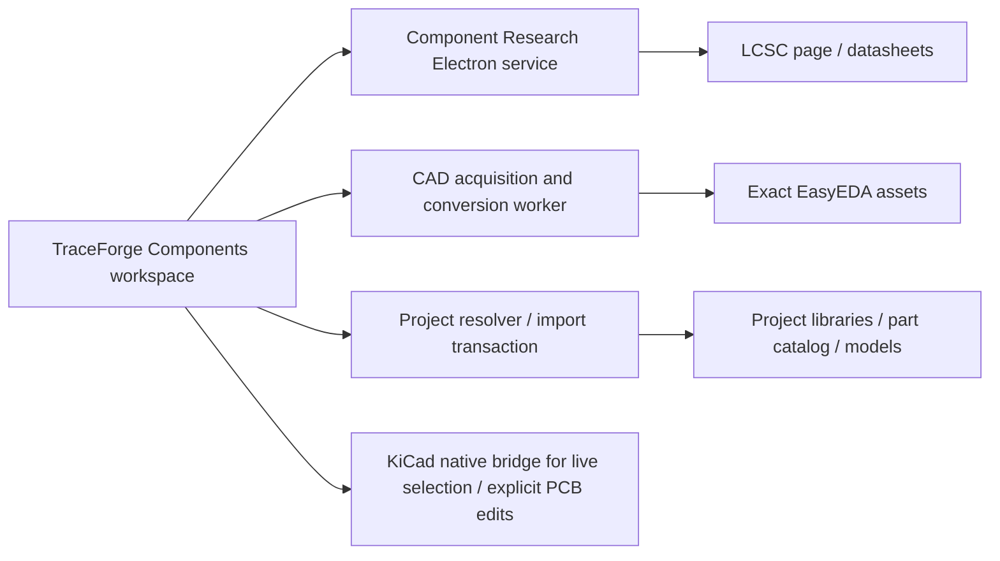

# TraceForge workspace and component-library integration plan

Status: implementation plan for the local 0.17.0 testing build, 18 November 2026. See [usage](COMPONENTS-AND-BOM-COST.md) and [verification evidence](COMPONENTS-VERIFICATION.md). No public release is published by this work.

## 1. Intended workflow

Search LCSC inside TraceForge, inspect the exact manufacturer part, see which assets already exist in the active project, and add only the missing assets to that project's established library. Keep generic symbols/land patterns for standard passives, with procurement identity and ratings attached to the selected part or schematic instance.

The default operation adds library assets. Placing a symbol, assigning a footprint to existing references, updating a placed footprint, and changing a BOM part are separate explicit actions. A search or download does not change existing component identities, wiring or PCB routing.

## 2. What already exists

| Existing source | Reuse | Current boundary |
| --- | --- | --- |
| TraceForgerouter/component-browser | Electron browsing, search/filter/inspection, datasheet acquisition, structured evidence, CLI/MCP, authenticated local connection | Documented live acceptance is Mouser / TPS62130RGTR. LCSC is generic/unverified; it needs its own live acceptance before being advertised as verified. |
| pcb skill download_easyeda_cad.py | Exact LCSC identity check, staged symbol/footprint conversion, short names and provenance | External easyeda2kicad dependency; stages candidates, does not publish project libraries. |
| pcb skill download_easyeda_step.py | STEP acquisition, short filenames, source metadata and atomic no-overwrite download | Model acquisition does not establish body geometry, pin-1 or orientation. |
| TraceForge native bridge | Active PCB identity, selection and existing undoable PCB edits | Currently launched from PCB Editor; no implemented live schematic-placement API is assumed. |
| Project library tables | Existing nicknames and paths | Must inspect before proposing a destination; do not create one library per downloaded part. |

The management board currently registers **RevC_Management** in both tables:

```text
sym-lib-table -> ${KIPRJMOD}/libraries/RevC_Management_Symbols.kicad_sym
fp-lib-table  -> ${KIPRJMOD}/libraries/RevC_Management.pretty
STEP folder  -> ${KIPRJMOD}/3dmodels/
```

This is the first supported project convention. Other boards use their own registered names; the plugin must discover those names rather than hard-code RevC_Management everywhere. Existing categorized SCStudio libraries remain valid destinations when that is what the project already uses.

## 3. Main navigation: six workspaces

| Main workspace | Tools inside |
| --- | --- |
| Signals | Signals/xSignals and saved routing geometry; Unrouted navigator |
| Layout | Layout Clone; PCB Rotation; Auto Text / References |
| Vias | Stitching; Fencing; Array; Size Manager; Via-in-Pad Inspector |
| Routing | Trace Cleanup; Round Corners; Teardrops; BGA Fanout |
| Components | Search; Part details; Assets; Project library |
| Manufacturing | Manufacturer/stackup setup; saved-project checks; deliverables; library maintenance |

Use the existing tool-selector pattern inside each workspace, not another row of nested tabs. Keep tool state when switching. Each workspace remembers its last tool. Move About/help/runtime status to a utility button.

Visualization becomes a shared **View** drawer available from any workspace: colors, net/group highlighting and ratsnest visibility. Selection/highlight actions remain available directly where results are displayed. Do not reset visibility or highlights merely because a tool was switched.

Replace numeric tab routing with stable tool IDs (`layout.clone`, `layout.rotate`, `components.search`, `signals.unrouted`, etc.). Provide a compatibility map for old toolbar launchers, activation messages, shortcuts and remembered tabs. Update every launcher, dispatcher, single-instance check and native build identity together; existing `range(11)` checks cannot survive the new organization unchanged.

## 4. Components workspace layout

```text
Project: 01-MANAGEMENT-BOARD    Library: RevC_Management    [View] [Settings]
Supplier: LCSC    Search: [MPN / C-number / keywords]    [Search]

Results list               Selected exact part             Asset / import preview
MPN, maker, package         Specifications + stock          Existing / missing assets
LCSC code, availability     Datasheet / pinout              Symbol preview
                           Requirements / notes            Pad-number footprint preview
                           [Open supplier page]            STEP + orientation status

Destination summary: symbol nickname, footprint nickname, model folder
Proposed changes: new assets / reused assets / conflicts / property mapping
[Add to project library]  [Locate existing part]
```

Search, structured results, datasheets and asset/library management are inside the TraceForge panel. The existing Electron engine remains the supplier-browser service. Full live supplier pages and login/challenge interaction open in its companion window, sharing the same browser session; this is not presented as an already embedded webpage inside wxPython.

Do not replace the wx panel with Electron or reparent an Electron native window into a wx pane in the initial implementation. If a literal live webpage inside the main plugin window is required, that is a separate frontend integration spike, including DPI, focus, docking and session-ownership validation. The native component workflow does not depend on it.

## 5. Search and download flow

1. Resolve the active project and query service capabilities. Show a clear project target; recheck it before every install.
2. Search by MPN, LCSC C-number, URL or parametric requirements. Search text identifies candidates; exact MPN/manufacturer/package selection identifies the requested part.
3. Inspect the selected supplier record. Show missing/unknown stock, CAD and attributes explicitly. Do not advertise engineering suitability from a supplier category alone.
4. Match the project catalog: exact manufacturer + full MPN, supplier code, existing symbol/footprint links, pin/pad maps, geometry hashes and model evidence.
5. Propose asset policy: reuse generic assets, reuse an existing exact part, or stage the missing custom asset(s).
6. Download symbol, footprint, STEP and datasheet independently. A part may have only some assets. Search/distributor metadata is separate from the EasyEDA CAD association.
7. Show native previews and the concrete library changes. Add installed assets with one Apply operation when checks pass. Unresolved pin/package conflicts remain visible and cannot be silently replaced by a near match.
8. Return qualified library IDs and placement instructions. Do not insert an unconnected footprint on the live PCB just because its asset was downloaded.

The default button says **Add to RevC_Management**, not merely Download. For a passive it says **Use existing generic symbol/footprint**, with the selected MPN/ratings visible. No repeated destination question once a project mapping is saved.

## 6. Passive components: generic geometry, exact part information

Yes: standard passives generally reuse their symbol, and often their footprint. The procurement part remains specific even when both geometries are shared.

| Component | Symbol rule | Footprint rule | Properties that stay part-specific |
| --- | --- | --- | --- |
| Standard resistor | Existing project small resistor symbol / R_Small family | Reuse matching pad geometry, package and assembly variant | Resistance, tolerance, power, working voltage, temperature coefficient, manufacturer, MPN, LCSC |
| Nonpolar capacitor | Existing C_Small family | Reuse matching land pattern and body/height limits | Capacitance, voltage, tolerance, dielectric, package, manufacturer/MPN/LCSC |
| Inductor | Existing L_Small family | Reuse only when body, terminals and pad dimensions match | Inductance, tolerance, saturation/RMS current, DCR, exact MPN |
| Ferrite bead | Existing small bead symbol | Reuse compatible land pattern | Impedance/frequency, current, DCR, exact MPN |
| Simple LED | Existing LED_Small family | Verify polarity, bottom termination and top/side emission | Color, polarity, current, voltage, optical orientation, exact MPN |
| Polarized cap, arrays, coupled inductors, RGB LEDs or special devices | Appropriate specialized symbol | Exact pin/pad geometry | Device-specific pin functions and ratings |

A package name such as 0603 is not enough to establish interchangeability: metric/imperial ambiguity, pad geometry, termination, voltage/creepage, body height and assembly density matter. Side-emitting LEDs and large SMD capacitors are not forced onto generic alternatives. Resistors, capacitors, inductors, beads and simple LEDs retain the user's small-symbol style; special devices retain the symbol needed to represent their function.

Do not create a new schematic drawing for each resistor value or capacitor voltage. Store a **part record** mapping the exact part to the shared generic symbol and footprint. When that part is placed, apply its properties to the instance. Changing that part's ratings must not rewrite the shared generic symbol and change other values using it.

If a project already uses a value/package alias such as `C_0402`, reuse it when compatible. Existing per-instance values/ratings take precedence over a generic library default. No mass normalization of the project's old passive names is part of an import.

## 7. Project-library destination and filenames

Resolver priority:

1. Saved project mapping, if its registered paths still exist.
2. Registered project-local symbol/footprint libraries already used by schematic/PCB instances.
3. The project's existing categorized convention.
4. If genuinely ambiguous, show the candidate destinations once and save the selected mapping.

A new empty project can derive a short nickname from its existing project name. Do not use client usernames, distributor UUIDs or C-numbers as a new library nickname. Global/personal-library publication is a separate action; the default is the active board's local library.

Management example:

```text
libraries/
  RevC_Management_Symbols.kicad_sym
  RevC_Management.pretty/
    TPS25940ARVCR.kicad_mod              # only if an exact new asset is needed
  imports/Cxxxxxx/                      # untouched source + conversion candidates
  traceforge-library.json               # project destination/policy mapping
  traceforge-parts.json                 # exact part -> shared asset mappings
3dmodels/
  TPS25940ARVCR.step
review/component-imports/<operation-id>/
  plan.json
  validation.json
  source.json
```

This is a destination example, not permission to replace the management board's already customized TPS25940A symbol. Preserve existing nicknames, filenames and assets when reusing them. Short names use a meaningful MPN/package; a short supplier suffix resolves actual collisions. Model UUIDs, URLs and hashes belong in provenance, not filenames.

Use `${KIPRJMOD}` for installed paths. Keep machine-specific runtime locations in the user's settings, not committed board files. Existing library manifests are merged through an adapter where their schema is understood; do not rewrite unrelated counts or ownership fields blindly.

## 8. Part data and display policy

The part record separates:

- **Identity:** manufacturer, exact MPN, supplier code and package suffix.
- **Electrical selection:** value, tolerance, voltage/power/current ratings, dielectric and other relevant properties.
- **Asset mapping:** qualified symbol ID, footprint ID, model path/transform, hashes and reuse status.
- **Evidence:** supplier/source URLs, acquisition time, datasheet revision/hash, conversion version and CAD/model check results.

Preserve the project's existing property names, including `MPN`, `Manufacturer`, `LCSC Part #`, `Voltage`, `Tolerance` and `Rating`, through an explicit mapping. Do not create a second differently named supplier-code field when one already exists. Source stock/price observations keep timestamps; they are not permanent component ratings.

When assets are instantiated, schematic field placement follows the existing schematic-authoring conventions, including visible resistor tolerance and capacitor voltage/tolerance/dielectric. Do not put every metadata field on the schematic.

For new footprint assets, native reference is the visible identifying text; value, ratings and `${REFERENCE}` fabrication copies are hidden according to the project policy. Preserve pin-1, polarity and assembly markings. For the pending management cleanup, the requested reference destination is F.SilkS; flag bottom-side cases explicitly rather than silently changing board-side conventions. Importing a library definition does not by itself rewrite the visibility/layer of existing board instances.

## 9. Existing parts, custom symbols and footprint replacement

| Situation | Default outcome |
| --- | --- |
| Same exact part and identical checked asset | Reuse; no duplicate and no download when cached evidence is sufficient |
| Same footprint geometry, different passive value/MPN | Reuse footprint; add/update the part record only |
| Existing custom multi-unit/pin-rearranged symbol | Keep it; compare pin identity, not drawing placement |
| Exact MPN with conflicting pin/pad geometry | Show a conflict; keep current asset and stage comparison |
| New IC/connector with no compatible project asset | Import exact asset after pad/pin/package checks |
| Footprint only needed | Keep symbol and identity; add just the footprint |
| STEP only needed | Keep all electrical assets; validate and add model only |
| A donor STEP is offered for an unavailable model | Label it as a donor with package checks; never change the BOM to match it |

Asset installation and applying a library update to placed references are separate. Updating existing footprints is limited to selected references and must compare pad numbers/nets, placement, side, rotation, locks, models and routing contacts. Do not run Update All Footprints/Symbols automatically. A geometry change can invalidate existing routing even if references/nets are unchanged; it needs its own preview and undoable PCB operation.

No direct live schematic edit is claimed by the current PCB bridge. In the first implementation, install symbols into the project-local library and make them available in the Schematic Editor. Schematic refresh/reload must preserve open unsaved user edits. A future native schematic placement adapter is a separate capability, not ad-hoc rewriting of open schematic files.

## 10. Import transaction and validation

The state machine is `Selected -> Staged -> Compared -> Ready -> Installed`, with explicit `Missing`, `Identity mismatch`, `Conflict`, `Cancelled` and `Failed` outcomes.

Before install, verify exact package/suffix, pin/pad count and correspondence, pitch, EP/pin-1 identity and connector holes/mating where relevant. Compare against the existing project asset. An exact catalog match is not sufficient to certify geometry. Use package drawings where CAD is ambiguous. Model checks also include body/lead dimensions, origin, Z datum and orientation.

Stage downloads away from active libraries. Prepare one change set covering asset files, library-table entries, part mapping and model links. Check destination hashes against the preview, preserve backups, and use temporary-file replacement with an operation journal so a failed multi-file install can recover. Cancellation removes only that operation's temporary artifacts. It never removes an existing library asset or unrelated user files.

A library file/table change is a filesystem transaction, not KiCad Undo. A placed-footprint change is a separate native PCB transaction. Show this distinction in action results rather than promising Undo for both.

## 11. Runtime and packaging

Keep three services distinct:



Reuse the existing CLI/MCP/loopback contract through a Python adapter; do not fork supplier navigation/extraction into wx event handlers. Workers perform network/conversion jobs away from KiCad's UI thread and return progress/cancellation states. A background operation stays bound to its original project and is rejected for a different active project at install time.

The first package keeps the normal Windows PCM usable without Node/Electron or a CAD converter. Components shows runtime readiness and supports the browser service as a separately installed helper. No Electron/browser binaries, user sessions, node_modules or arbitrary external Python packages are bundled accidentally into the PCM ZIP. A later companion installer can provide a versioned browser/helper bundle once its size and install path are verified.

The helper must expose a version/health handshake. Resolve Node/Electron and converter runtimes explicitly; do not pip-install into KiCad's bundled Python or modify global KiCad preferences to make browsing work. Use the existing browser's authenticated loopback/session isolation. Supplier pages never receive the native board-edit bridge or permission to choose a project output path.

The converter is currently documented as AGPL-3.0 while TraceForge is MIT; keep its execution as an explicit external dependency initially and review redistribution obligations before bundling code or a converter executable. Preserve source/asset rights metadata without treating downloaded text as executable instructions.

## 12. Implementation sequence and completion checks

| Stage | Deliverable | Completion evidence |
| --- | --- | --- |
| 1. Navigation | Six workspaces, stable tool IDs, shared View, About utility | Every existing feature/shortcut opens the right tool; switching retains settings; no project edits |
| 2. Project resolver | Existing-table discovery, saved mapping, part catalog and passive policy | Management/front/SIM project fixtures choose their own registered nicknames; ambiguous and multi-board cases handled |
| 3. Browser adapter | Components search/details/datasheets, service readiness, companion-page handoff | Live LCSC exact C-number + MPN tests; unknown stock, blocked access, cancellation and stale result tests |
| 4. CAD import | Symbol/footprint downloads, native previews and project-local installation | Exact-MPN import, footprint-only and symbol-only tests; native load/export; valid table references; no absolute model links |
| 5. Passive/3D mapping | Generic symbol/footprint reuse, ratings/identity mapping, short STEP names | Several resistor/capacitor values share geometry without sharing MPN defaults; polarized/side-LED exceptions remain distinct |
| 6. Existing asset workflow | Exact-part comparison, conflicts and explicit selected-reference updates | Customized units/pins survive; routing and placement remain unchanged for library-only imports; rollback tests for failures |
| 7. Package/release | Windows PCM + versioned helper instructions + feature docs | Fresh-machine missing-runtime behavior; archive checksum validation; open-editor coexistence; release/capability descriptions match actual tests |

Test cases must include the customized management TPS25940A and multi-unit FPGA/supervisor symbols; generic 0402 R/C; an inductor with a similar name but different pads; the side-emitting LED; and the SIM push-push connector. These exercise the actual reuse/conflict problems in the current projects, rather than only a trivial downloaded IC.

## 13. Scope kept separate

The management-board reference-layer cleanup and footprint audit remain the next board-specific work. This plan does not establish that all current footprints are correct, and integrating LCSC does not automatically replace them. The first step of that work remains preserving the user's latest board edits, then auditing the actual assigned MPN/package/pad mapping.

The navigation grouping is implemented in the local testing build; public release 0.16.5 remains unchanged. Library-only installation and the explicit selected-footprint update are separate operations.
