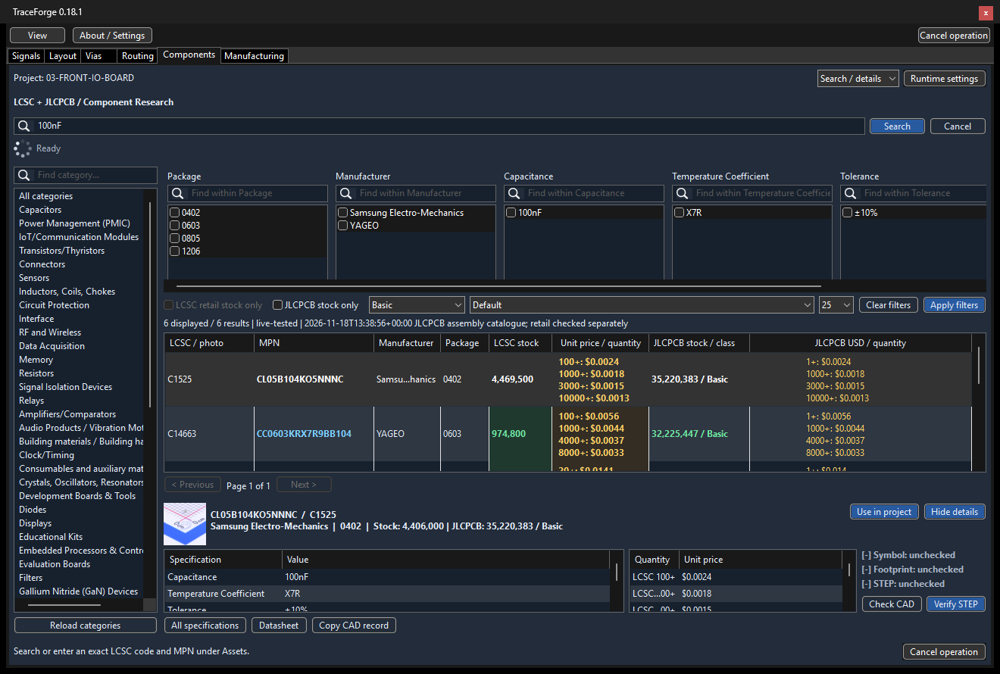
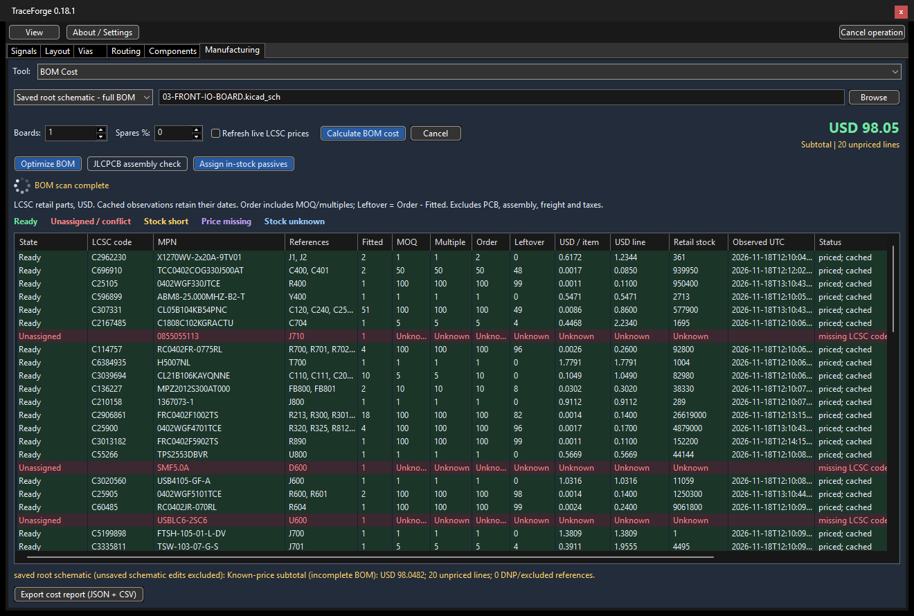
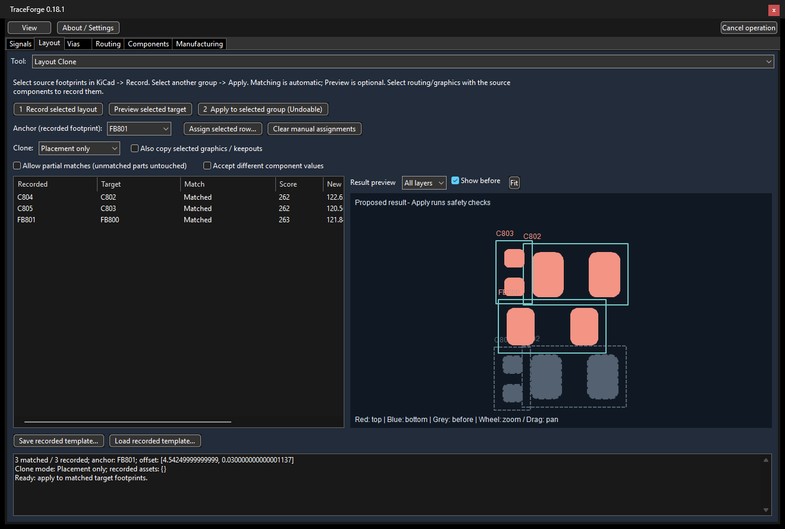

# TraceForge 0.18.1 ? Components and BOM optimization

Windows release for KiCad 10. This release brings the Components workspace and BOM workflows into the six-workspace interface, with scanning progress and fixes for layout preview, selection, cancellation and category typing.

## Components: combined LCSC and JLCPCB research

- Search by keyword, manufacturer part number or C-number; browse categories and horizontal parametric filters without opening another research window.
- Combine matching C-number/MPN/package records while keeping LCSC retail stock/prices separate from JLCPCB assembly stock/prices. Conflicts remain unmerged; unavailable data stays Unknown.
- Filter Basic, Extended or Preferred Extended parts and assembly availability against the JLCPCB catalogue. Switching catalogue mode loads its corresponding categories and facets.
- Inspect specifications, product images, quantity prices and colored symbol/footprint/STEP availability states. Hand selected parts to the existing staged CAD/project-library import workflow.
- Typing in Find category retains focus and caret, updates only suggestions and never automatically selects a category. Click a category or confirm with Enter/Space to start research. Applying electrical filters retains alternative choices.
- Visible activity indicates catalogue searches, category/filter loading, supplier stock checks, details and CAD verification. Cancel discards late results.

## Manufacturing: BOM cost, assignment and optimization

- Cost a full saved root schematic or live PCB. Resolve supplier-field aliases and unique exact MPN identities while keeping ambiguous parts unassigned.
- Compute fitted quantity, requested spares, supplier MOQ/order multiples, purchase quantity, leftover quantity and USD tier pricing. Reel size is not substituted for MOQ. Unknown order constraints remain unpriced.
- Display a prominent total/subtotal and distinct Ready, Unassigned/conflict, Stock short, Price missing and Stock unknown states. Export CSV and JSON with dated observations and identity evidence.
- **JLCPCB assembly check** adds assembly classification and stock to the report without mixing them into the retail estimate.
- **Optimize BOM** finds compatible Basic alternatives. **Assign in-stock passives** searches available resistor/capacitor equivalents across Basic and Extended classes, prefers Basic, and preselects verified proposals for batch assignment.
- Keep nominal value and footprint/package fixed. Configure tolerance and capacitor dielectric; preserve/increase capacitor voltage and resistor power, and check known resistor voltage and temperature coefficient. Unknown required specifications block proposals.
- Check aggregate assembly stock when several selected groups use the same replacement. Recheck identity, compatibility, classification where required, and stock before committing.
- Update only selected instance information through guarded schematic/PCB transactions. Shared generic libraries, component positions, pads, nets and routing remain intact. Save PCB field changes in KiCad after review.
- Show current references, active update stage, completed groups and the incremental BOM refresh in the loading panel. Already committing atomic updates finish safely before cancellation stops the remaining queue.
- Replacing a component updates affected BOM groups and totals using existing quotes; it does not re-export or research the whole project. Selection, scroll and research filters remain usable.

## Layout and integration fixes

- Layout Clone retains automatic matching and placement/routing/both modes, with rotated-target transforms, net remapping and optional graphics/keepouts.
- Fix interactive preview rendering, including blocked and empty states. Preview supports layers, before/after, zoom, pan and fit.
- BOM reference focus uses the same native highlight/zoom path as Signals, including the missing UI-runner feedback callbacks.
- Cancel reaches research, BOM calculation, staging, manufacturing checks and cancellable native previews; late callbacks cannot overwrite a cancelled operation.
- Window ownership/activation keeps utility pages accessible above their TraceForge parent. The version/build handshake prevents reuse of stale panels/helpers.
- The project component field schema is bundled. Passive imports preserve reusable small symbols and project-local library/model conventions. A separate Components launcher supports saved schematic projects through KiCad's BOM-tool integration; this is not a native schematic ActionPlugin API.

## Install

Download **TraceForge-0.18.1-KiCad10-PCM.zip** from this release. In KiCad Manager choose **Plugin and Content Manager ? Install from file**. Remove an older PCM installation first if necessary, then restart KiCad. The panel and About information should show **0.18.1**.

The Windows PCM ZIP bundles the native research UI/backend; no PySide6 or embedded browser is needed for catalogue research. CAD conversion and manufacturing spreadsheets require their separately configured external helpers. Avoid keeping an older manual plugin copy alongside PCM.

## Scope and verification

Stock and prices are observations of supplier website APIs, which may change or be unavailable. Retail totals exclude fabrication, assembly, shipping and taxes. Optimization compares component estimates and reported purchase/placement minima; it is not a complete assembly quote. Candidate searches inspect up to 100 results per value/package per catalogue-class query; unknown constraints are not guessed. CAD availability/header checks do not certify footprint geometry or model orientation.

Verified with live JLCPCB Basic/Extended searches, category/facet requests, independent LCSC/JLCPCB inventory, a real capacitor alternative, 326 unit tests and native wx checks for loading, focus, cancellation, incremental BOM updates, checked-only assignment and preview painting. Screenshots use the front I/O project. Layout Clone was previewed against an unrouted target in a temporary in-memory copy; the original project was not modified.

## Refreshed 0.18.1 package ? 18 November 2026

The existing Windows PCM asset has been replaced with the current fixes:

- Unified manufacturer/MPN and supplier field aliases; supplier-neutral saved identities for DigiKey, Mouser, element14 and custom suppliers. No live stock or price is inferred from saved data.
- Separate exact-MPN assignment for all component types. Metadata assignment finds all exact occurrences across hierarchy, including unassigned and DNP copies, retaining assembly flags.
- Native multiline-string parsing, root/child-sheet lock checks, local stale-lock detection and custom-supplier revalidation fixes.
- Exclusive component-changing operations, bounded content-checked sheet reuse, named progress phases/elapsed activity and one incremental BOM refresh per batch.
- Cancel immediately dismisses passive/exact-MPN windows. Cancelling replacement returns to Manufacturing and clears Components assignment mode. Active atomic writes finish or roll back safely under the operation guard.
- Layout Clone supports repeated hierarchical sheets and nested instances, plus selected FPGA/header groups across different branches. Placement-only handles connectivity differences with a warning; routing reuse retains topology checks.
- BGA Fanout adds optional local width retries, configurable signal/power order and visible actual/preferred widths.

Validation: 353 unit tests passed (one skipped), targeted native wx cancellation tests, native clone/assignment tests and PCM archive verification. Cancellation modal tests covered idle, scan, preparation, commit and refresh for both assignment modes; manual replacement navigation was checked separately. These checks do not replace end-user validation of every board and supplier response.

### Layout Clone follow-up

- Added **Check copper clearance**, enabled by default; uncheck to bypass clone copper-clearance preflight without changing KiCad design rules. Net mapping and component identity checks remain enforced.
- Selected copper graphics can be cloned with placement/routing; unnetted artwork stays unnetted.
- Verified the supplied FPGA PSU layout on a disposable native board: 30 footprints, 135 tracks, 43 vias and 33 copper graphics.
